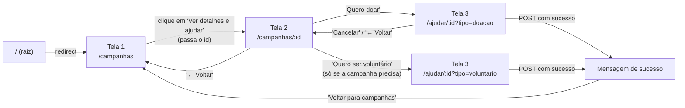
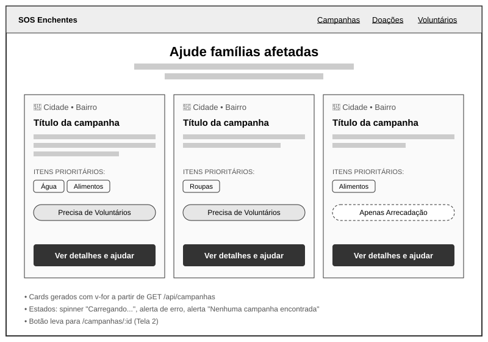
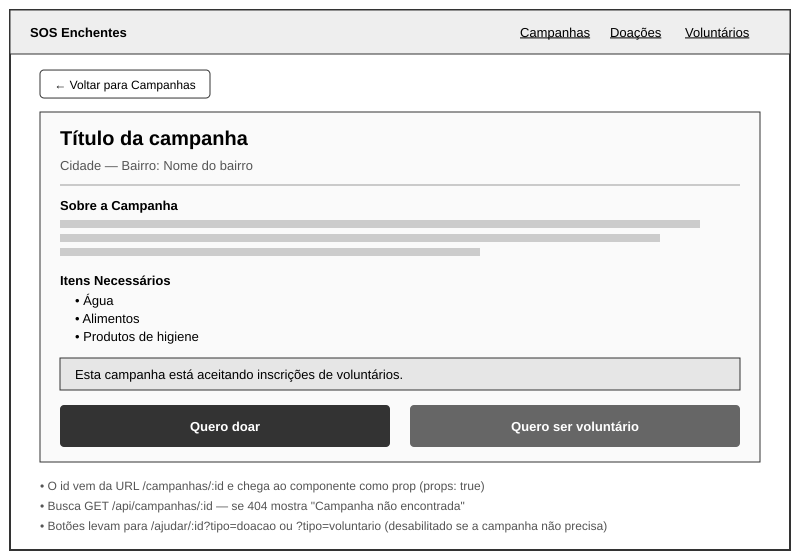
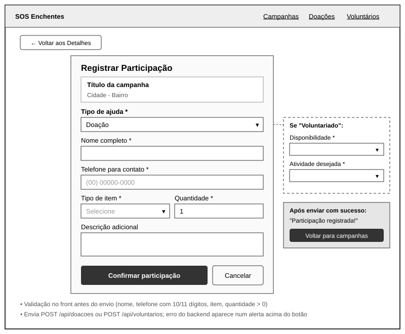
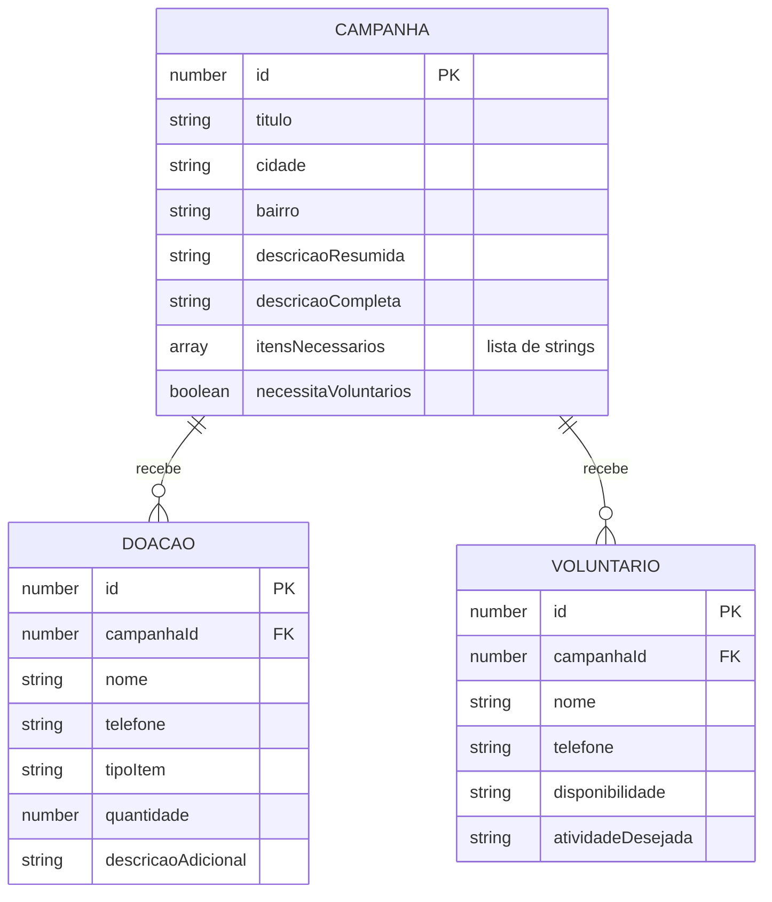
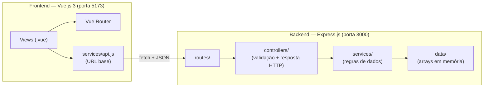

# Documentação Técnica — SOS Enchentes: Gestão de Doações e Voluntários

**UNIVALI — Programação Web — Prof. Welington Gadelha — Extensão M2**

| Integrantes | 
|---|---|
| Aquiles |
| Maria Isabel Henke |
| Matheus Cadore | 
| Yasmin Inturn Nascimento |

## Sumário
1. [Contextualização social e escopo extensionista](#1-contextualização-social-e-escopo-extensionista)
2. [Especificação da interface e navegação (Vue.js)](#2-especificação-da-interface-e-navegação-vuejs)
3. [Especificação da API REST (Node.js + Express.js)](#3-especificação-da-api-rest-nodejs--expressjs)
4. [Modelagem simplificada de dados](#4-modelagem-simplificada-de-dados)
5. [Arquitetura e organização do código](#5-arquitetura-e-organização-do-código)

---

## 1. Contextualização social e escopo extensionista

### 1.1 Entidade comunitária atendida

**Rede Solidária Margem do Itajaí** *(entidade fictícia, criada para fins acadêmicos)*

Associação comunitária sem fins lucrativos, com sede em Itajaí (SC), formada por moradores de bairros ribeirinhos do Vale do Itajaí. Ela atua em situações de enchente organizando a arrecadação de alimentos, água, roupas e materiais de higiene e limpeza, e coordenando voluntários para triagem e distribuição. Não tem funcionários: depende de lideranças de bairro e voluntários, e hoje organiza tudo por grupos de WhatsApp e planilhas.

O Vale do Itajaí (SC) sofre com enchentes recorrentes que atingem bairros como Cordeiros (Itajaí), Machados (Navegantes), Itoupava Norte (Blumenau) e Santa Rita (Brusque). Nesses momentos, entidades comunitárias organizam campanhas de arrecadação e mobilizam voluntários, mas normalmente fazem isso por grupos de WhatsApp, planilhas e listas em papel.

### 1.2 Problema e justificativa

Durante uma enchente, a entidade enfrenta problemas como:

- **Informação espalhada:** quem quer ajudar não sabe quais campanhas estão ativas nem o que cada uma precisa.
- **Doações erradas:** chegam itens que a campanha não pediu (ex.: roupas em uma campanha que só precisa de alimentos), ocupando espaço e tempo de triagem.
- **Voluntários sem direcionamento:** pessoas se oferecem para campanhas que não precisam de voluntários, ou sem informar quando podem ajudar.
- **Falta de registro:** a entidade não tem uma lista organizada de quem doou o quê e de quem se ofereceu para ajudar.

A aplicação **SOS Enchentes** centraliza as campanhas em um único lugar, mostra o que cada uma precisa e registra doações e voluntários de forma organizada. Assim, a comunidade ajuda de forma mais eficiente e a entidade economiza tempo de organização.

### 1.3 Perfis de usuários

| Perfil | Quem é | O que faz no sistema |
|---|---|---|
| **Doador** | Morador ou empresa que quer doar itens | Consulta campanhas, vê os itens necessários e registra uma doação |
| **Voluntário** | Pessoa que quer ajudar com trabalho | Consulta campanhas que precisam de voluntários e registra sua disponibilidade |
| **Administrador da entidade** | Organizador da campanha na ONG | Consulta as listas de doações e voluntários registrados para organizar a logística |

> Nesta versão não há login. As telas de consulta (`/doacoes` e `/voluntarios`) representam a visão do administrador.

### 1.4 Requisitos funcionais

| ID | Requisito |
|---|---|
| RF01 | Listar todas as campanhas ativas, com cidade, bairro, resumo, itens prioritários e se precisa de voluntários |
| RF02 | Exibir os detalhes de uma campanha específica a partir do seu ID |
| RF03 | Registrar uma doação vinculada a uma campanha |
| RF04 | Registrar um voluntário vinculado a uma campanha |
| RF05 | Listar as doações registradas, com o nome da campanha |
| RF06 | Listar os voluntários registrados, com o nome da campanha |

### 1.5 Requisitos não funcionais

| ID | Requisito |
|---|---|
| RNF01 | Frontend em Vue.js 3 como SPA (Vue Router, sem recarregar a página) |
| RNF02 | Backend em Node.js + Express.js, com API REST em JSON |
| RNF03 | Dados armazenados em memória (arrays de objetos em arquivos dedicados) |
| RNF04 | Interface responsiva (Bootstrap 5) e com estados de carregamento e erro |

### 1.6 Regras de negócio

| ID | Regra |
|---|---|
| RN01 | Toda doação e todo voluntário devem estar vinculados a uma campanha existente |
| RN02 | Uma doação só pode ser de um item que está na lista `itensNecessarios` da campanha |
| RN03 | A quantidade doada deve ser um número inteiro maior que zero |
| RN04 | Só é possível se voluntariar em campanhas com `necessitaVoluntarios = true` |
| RN05 | Nome é obrigatório e o telefone deve ter 10 ou 11 dígitos (com DDD) |
| RN06 | Disponibilidade deve ser: Manhã, Tarde, Noite ou Integral |
| RN07 | Atividade desejada deve ser: Organização de doações, Distribuição de materiais, Apoio logístico ou Qualquer atividade |

As regras são validadas **no frontend** (para dar retorno rápido ao usuário) e **no backend** (para garantir que nenhum dado inválido seja salvo).

---

## 2. Especificação da interface e navegação (Vue.js)

### 2.1 Mapa de rotas (Vue Router)

Arquivo: `frontend/src/router/index.js` — usa `createWebHistory()`, então a URL muda sem recarregar a página.

| Rota | Nome | Componente | Parâmetro | Descrição |
|---|---|---|---|---|
| `/` | — | — | — | Redireciona para `/campanhas` |
| `/campanhas` | `Campanhas` | `CampanhasView.vue` | — | **Tela 1** — listagem das campanhas |
| `/campanhas/:id` | `DetalhesCampanha` | `DetalhesCampanhaView.vue` | `id` (via props) | **Tela 2** — detalhes de uma campanha |
| `/ajudar/:id` | `Ajudar` | `AjudarView.vue` | `id` (via props) + `?tipo=` (query) | **Tela 3** — formulário de doação ou voluntariado |
| `/doacoes` | `Doacoes` | `DoacoesView.vue` | — | Lista de doações (visão do administrador) |
| `/voluntarios` | `Voluntarios` | `VoluntariosView.vue` | — | Lista de voluntários (visão do administrador) |
| `/:pathMatch(.*)*` | `NaoEncontrada` | `NaoEncontradaView.vue` | — | Página 404 para qualquer outra URL |

### 2.2 Parâmetros dinâmicos

**Sintaxe:** o `:` na rota indica um parâmetro dinâmico. Em `/campanhas/:id`, a URL `/campanhas/2` faz `id` valer `"2"`.

**Como o parâmetro chega ao componente:** as rotas com `:id` usam `props: true`. Com isso, o Vue Router entrega `$route.params.id` ao componente como uma **prop** chamada `id`:

```js
// router/index.js
{ path: '/campanhas/:id', component: DetalhesCampanhaView, props: true }

// DetalhesCampanhaView.vue
export default {
  props: ['id'],
  methods: {
    async carregarCampanha() {
      const response = await fetch(`${API_URL}/campanhas/${this.id}`)
      // ...
    }
  }
}
```

Usar props em vez de `this.$route.params.id` deixa o componente menos dependente do router e mais fácil de reutilizar.

**Reatividade do parâmetro:** se o `id` mudar sem o componente ser desmontado, um `watch` busca a campanha de novo:

```js
watch: {
  id() {
    this.carregarCampanha()
  }
}
```

**Query string:** na Tela 3, `?tipo=doacao` ou `?tipo=voluntario` define qual formulário aparece primeiro. Ela é lida com `this.$route.query.tipo`.

### 2.3 Fluxo de navegação



1. **Tela 1 → Tela 2:** cada card tem um `<router-link :to="`/campanhas/${campanha.id}`">`. O clique muda a URL e o Vue Router troca o componente, sem recarregar a página.
2. **Tela 2 → Tela 3:** os botões levam para `/ajudar/:id?tipo=doacao` ou `?tipo=voluntario`. O botão de voluntário fica desabilitado se a campanha não precisa de voluntários.
3. **Depois de enviar o formulário (Tela 3):** quando o backend responde `201`, o formulário some e aparece uma mensagem de sucesso com o botão **"Voltar para campanhas"**, que leva de volta à Tela 1. Se o backend responder com erro (`400`/`404`), a mensagem de erro aparece no formulário e o usuário pode corrigir.

### 2.4 Esboço das telas (wireframes de baixa fidelidade)

#### Tela 1 — Visão Geral (`/campanhas`)


- Consome `GET /api/campanhas` ao montar a página (`mounted`).
- Renderiza um card por campanha com `v-for`.
- Estados de interface: **carregando** (spinner), **erro** (alerta vermelho) e **lista vazia** (alerta amarelo).

#### Tela 2 — Detalhes (`/campanhas/:id`)


- Recebe o `id` da URL via props e consome `GET /api/campanhas/:id`.
- Mostra descrição completa, itens necessários e se aceita voluntários.
- Se a API responder `404`, mostra "Campanha não encontrada".

#### Tela 3 — Ação / Cadastro (`/ajudar/:id`)


- Busca a campanha para mostrar o resumo e montar o select **só com os itens que ela precisa**.
- Os campos mudam conforme o tipo de ajuda (doação ou voluntariado), usando `v-if`.
- Valida os campos no front antes de enviar e depois faz `POST /api/doacoes` ou `POST /api/voluntarios`.
- Botão "Confirmar participação" fica desabilitado e mostra "Enviando..." durante a requisição.

---

## 3. Especificação da API REST (Node.js + Express.js)

**URL base:** `http://localhost:3000/api`
**Formato:** todas as requisições e respostas usam JSON (`Content-Type: application/json`).
**Middlewares:** `cors()` (permite o frontend na porta 5173 acessar a API na porta 3000) e `express.json()` (converte o corpo da requisição em objeto JavaScript).

### 3.1 Mapa de endpoints

| Método | Endpoint | Descrição | Sucesso | Erros |
|---|---|---|---|---|
| GET | `/api/campanhas` | Lista todas as campanhas | 200 | — |
| GET | `/api/campanhas/:id` | Busca uma campanha pelo ID | 200 | 400, 404 |
| GET | `/api/doacoes` | Lista as doações registradas | 200 | — |
| POST | `/api/doacoes` | Registra uma nova doação | 201 | 400, 404 |
| GET | `/api/voluntarios` | Lista os voluntários registrados | 200 | — |
| POST | `/api/voluntarios` | Registra um novo voluntário | 201 | 400, 404 |

### 3.2 Códigos de status utilizados

| Código | Significado | Quando é usado |
|---|---|---|
| **200 OK** | Requisição bem-sucedida | Listagens e busca por ID |
| **201 Created** | Recurso criado | Doação ou voluntário registrado |
| **400 Bad Request** | Dados inválidos | ID não numérico, campo obrigatório vazio, item fora da campanha, JSON malformado |
| **404 Not Found** | Não encontrado | Campanha inexistente ou rota da API que não existe |
| **500 Internal Server Error** | Erro inesperado no servidor | Qualquer falha não prevista |

Todos os erros seguem o mesmo formato:
```json
{ "erro": "Mensagem explicando o problema" }
```

### 3.3 Payloads (exemplos de requisição e resposta)

#### `GET /api/campanhas` → 200
```json
[
  {
    "id": 1,
    "titulo": "Ajuda às famílias de Itajaí",
    "cidade": "Itajaí",
    "bairro": "Cordeiros",
    "descricaoResumida": "Arrecadação de alimentos e água para famílias atingidas pelas enchentes.",
    "descricaoCompleta": "Esta campanha tem como objetivo arrecadar alimentos não perecíveis, água potável e produtos de higiene...",
    "itensNecessarios": ["Água", "Alimentos", "Produtos de higiene"],
    "necessitaVoluntarios": true
  }
]
```

#### `GET /api/campanhas/:id`

Sucesso — `GET /api/campanhas/1` → **200**: retorna o objeto da campanha (mesmo formato acima).

Erros:
```http
GET /api/campanhas/abc   →   400
{ "erro": "ID inválido" }

GET /api/campanhas/99    →   404
{ "erro": "Campanha não encontrada" }
```

#### `POST /api/doacoes`

Requisição:
```json
{
  "campanhaId": 1,
  "nome": "Maria Silva",
  "telefone": "(47) 99999-0000",
  "tipoItem": "Água",
  "quantidade": 10,
  "descricaoAdicional": "10 garrafas de 1,5L"
}
```

Resposta **201**:
```json
{
  "id": 1,
  "campanhaId": 1,
  "nome": "Maria Silva",
  "telefone": "(47) 99999-0000",
  "tipoItem": "Água",
  "quantidade": 10,
  "descricaoAdicional": "10 garrafas de 1,5L"
}
```

Erros possíveis:

| Situação | Status | Resposta |
|---|---|---|
| `campanhaId` ausente ou não numérico | 400 | `{ "erro": "ID da campanha inválido" }` |
| Nome vazio | 400 | `{ "erro": "Nome é obrigatório" }` |
| Telefone sem 10 ou 11 dígitos | 400 | `{ "erro": "Telefone inválido" }` |
| `tipoItem` fora da lista geral | 400 | `{ "erro": "Tipo de item inválido" }` |
| Quantidade não inteira ou ≤ 0 | 400 | `{ "erro": "Quantidade inválida" }` |
| Campanha não existe | 404 | `{ "erro": "Campanha não encontrada" }` |
| Item não está em `itensNecessarios` da campanha | 400 | `{ "erro": "Esta campanha não está arrecadando este item" }` |
| Corpo com JSON malformado | 400 | `{ "erro": "JSON inválido" }` |

#### `GET /api/doacoes` → 200

Retorna as doações com o título da campanha incluído (`campanhaTitulo`), para a tela não precisar fazer outra requisição:
```json
[
  {
    "id": 1,
    "campanhaId": 1,
    "nome": "Maria Silva",
    "telefone": "(47) 99999-0000",
    "tipoItem": "Água",
    "quantidade": 10,
    "descricaoAdicional": "10 garrafas de 1,5L",
    "campanhaTitulo": "Ajuda às famílias de Itajaí"
  }
]
```

#### `POST /api/voluntarios`

Requisição:
```json
{
  "campanhaId": 2,
  "nome": "João Souza",
  "telefone": "47988887777",
  "disponibilidade": "Tarde",
  "atividadeDesejada": "Apoio logístico"
}
```

Resposta **201**:
```json
{
  "id": 1,
  "campanhaId": 2,
  "nome": "João Souza",
  "telefone": "47988887777",
  "disponibilidade": "Tarde",
  "atividadeDesejada": "Apoio logístico"
}
```

Erros possíveis:

| Situação | Status | Resposta |
|---|---|---|
| `campanhaId` inválido | 400 | `{ "erro": "ID da campanha inválido" }` |
| Nome vazio | 400 | `{ "erro": "Nome é obrigatório" }` |
| Telefone inválido | 400 | `{ "erro": "Telefone inválido" }` |
| Disponibilidade fora da lista | 400 | `{ "erro": "Disponibilidade inválida" }` |
| Atividade fora da lista | 400 | `{ "erro": "Atividade desejada inválida" }` |
| Campanha não existe | 404 | `{ "erro": "Campanha não encontrada" }` |
| Campanha não precisa de voluntários | 400 | `{ "erro": "Esta campanha não precisa de voluntários" }` |

#### `GET /api/voluntarios` → 200

Mesmo formato do POST, com `campanhaTitulo` incluído em cada registro.

---

## 4. Modelagem simplificada de dados

Os dados ficam em **arrays de objetos em memória**, um arquivo por entidade na pasta `backend/data/`. Por estarem em memória, doações e voluntários registrados são perdidos quando o servidor reinicia. As campanhas são fixas (mock data).

### 4.1 Diagrama das entidades



Uma campanha pode ter **várias** doações e **vários** voluntários; cada doação ou voluntário pertence a **uma** campanha (relação 1:N pelo campo `campanhaId`).

### 4.2 Sobre a entidade Doador

Para simplificar, o **doador não é uma entidade separada**: os dados dele (`nome` e `telefone`) ficam dentro de cada doação. Assim não é preciso cadastro nem login para doar, o que facilita a participação da comunidade em uma emergência. Em uma versão futura com banco de dados, `Doador` poderia virar uma tabela própria, ligada às doações por `doadorId`.

### 4.3 Estrutura dos arquivos de dados

```js
// backend/data/campanhas.js — dados fixos (mock)
export const campanhas = [
    {
        id: 1,
        titulo: "Ajuda às famílias de Itajaí",
        cidade: "Itajaí",
        bairro: "Cordeiros",
        descricaoResumida: "...",
        descricaoCompleta: "...",
        itensNecessarios: ["Água", "Alimentos", "Produtos de higiene"],
        necessitaVoluntarios: true
    },
    // ... mais 3 campanhas
];

// backend/data/doacoes.js — começa vazio, preenchido pelo POST
export const doacoes = [];

// backend/data/voluntarios.js — começa vazio, preenchido pelo POST
export const voluntarios = [];
```

### 4.4 Valores permitidos

| Campo | Valores |
|---|---|
| `tipoItem` | Água, Alimentos, Roupas, Produtos de higiene, Produtos de limpeza, Outros |
| `disponibilidade` | Manhã, Tarde, Noite, Integral |
| `atividadeDesejada` | Organização de doações, Distribuição de materiais, Apoio logístico, Qualquer atividade |

---

## 5. Arquitetura e organização do código



**Backend — separação em camadas:**

| Pasta | Responsabilidade |
|---|---|
| `routes/` | Define as URLs e qual controller atende cada uma |
| `controllers/` | Lê `req.params` e `req.body`, valida os dados e responde com `res.status().json()` |
| `services/` | Busca, cria e lista os registros nos arrays |
| `data/` | Arrays em memória (a "base de dados") |

**Frontend:**

| Pasta/arquivo | Responsabilidade |
|---|---|
| `src/router/index.js` | Rotas da SPA |
| `src/views/` | Uma view por tela |
| `src/services/api.js` | URL base da API, usada em todos os `fetch` |
| `src/App.vue` | Layout geral (barra de navegação + `<router-view />`) |

Para instruções de execução, veja o [README](../README.md).
